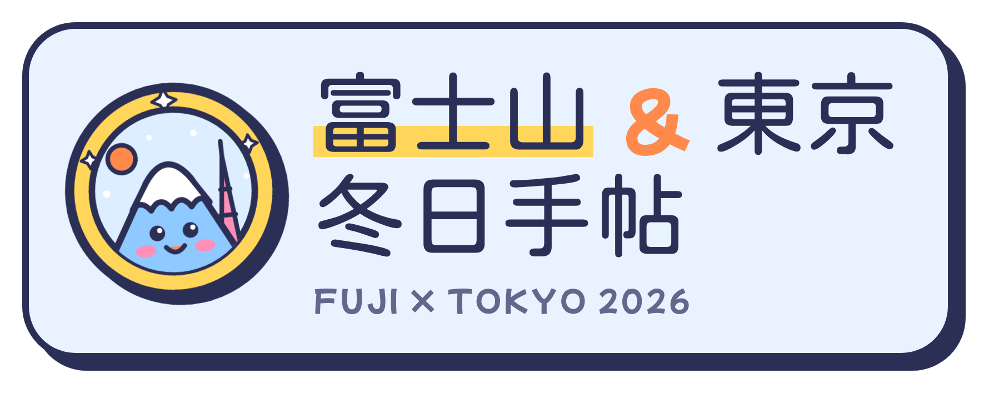

# 富士山 & 東京冬日手帖 🗻

2026/12/4–12/9 富士五湖＋東京 6 天 5 夜的互動旅遊手冊，手機優先設計。

## 功能
- **行程**：每日時間軸，附 Google 地圖連結與導遊提醒
- **景點**：景點與 63 家餐廳圖鑑，美食細分燒肉、拉麵、鄉土料理、壽司、鍋物、和食、咖啡廳、蔬食、甜點；依 Google 地圖評分與評論數綜合分級；附可愛風地圖（OpenStreetMap 底圖，滾輪／兩指縮放），顯示你的位置、住宿、距離與 Google 路線連結
- **小富懸浮對話**（右下角圓球，任何頁面都能點開）：內建旅遊知識引擎，讀你的行程、住宿、航班、景點與 63 家餐廳回答行程、美食、交通、天氣、日文、退稅等問題，不需網路也不需 API 金鑰
- **必玩・必吃・必買榜**：依行程挑選的三份 TOP 10，完成可蓋「GET!」章
- **臨時排**：依當下時間、所在區域、空檔、想做的事和天氣，即時推薦順路景點，檢查來不來得及接回原行程，可一鍵加入當天行程
- **連結**：Visit Japan Web、出國登錄、航空、巴士、匯率等常用連結
- **行程提醒**（右上角鈴鐺）：開關切換；提醒方式可選「網頁卡片／手機通知／兩者都要」，提前 5／10／15／30 分鐘，可加開始時再提醒、提示音、震動（頁面開著時運作；iPhone 需先「加入主畫面」才能用手機通知）
- **記帳**：手動新增或「拍明細快速記帳」——拍收據自動讀出金額、日期、店名、類別與付款方式（瀏覽器內文字辨識 Tesseract.js，不上傳；支援日文與繁體中文明細，可自動判斷或手動指定語言），日圓自動換算台幣、分類與每日統計、預算進度；可記「幫誰付」，多選自動平分，代墊帳統計待收回金額、一鍵標記收回
- **資料備份**：記帳頁可匯出／匯入備份檔，或複製／貼上備份文字（iPhone 刪除主畫面圖示會清掉資料，記得備份）
- **清單**：預約與行李勾選清單，可新增、改名、刪除項目或整份清單（儲存在瀏覽器）
- **撇步**：氣溫、交通票價、日語放大小卡

## 使用
單一檔案 `index.html`，直接用瀏覽器開啟，或開啟 GitHub Pages：
Settings → Pages → Source 選 `main` 分支 `/ (root)`。

> 資料整理於 2026 年 10 月，多數 2026 年活動日期尚未公布，出發前請再確認官方資訊。

# 行程&期望活動
- 參考行程：[schedule.txt](schedule.txt)
- 2026/12/05 早上安排富士環湖路跑
  - 有 2 隊情侶路跑
  - 有 1 隊情侶自由活動
  - 建議分成兩個部分行程內容
    - 路跑行程
      - 需注意開跑路線：12/04 住宿：富士河口湖の森，交通：自駕
    - 自由行程
- 綜合評估參考行程，提供建議、調整、優缺項，列到 [schedule-suggestion.txt](schedule-suggestion.txt)
  - suggestion 需經由作者審核，如果審核通過，才能修改 index.html

